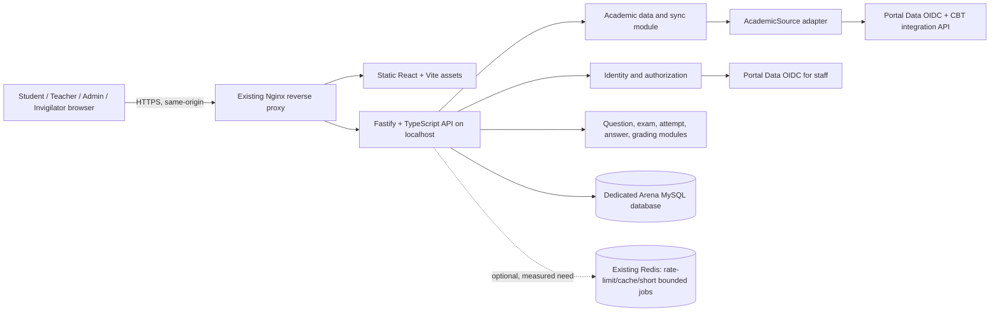

# Arena CBT Rebuild — Architecture Proposal (Draft)

Status: discovery and architecture proposal; schema and production migrations are not approved.

## Confirmed requirements

- Portal Data MAN 1 in this repository is the initial academic source. It is not assumed to be the SIPADU API itself. Keep an academic-source adapter boundary so another provider can be added later.
- Synchronize students, teachers, employees, classes, academic years, semesters, and class enrollments into Arena's own database. Student exam traffic must not call the academic provider.
- Students authenticate with NISN and a local Arena PIN. Store only a secure password hash; apply rate limits, expiring/revocable sessions, and security audit events. Keep this authentication behind a replaceable provider interface.
- Teachers and employees continue to authenticate through the existing Portal Data OIDC integration.
- One primary attempt is allowed per student per exam assignment by default. Extra attempts require an authorized teacher/admin action with a reason, kind, deadline, and audit record. Preserve prior answers and grades. The exam must explicitly define which attempt/result is authoritative.
- Do not claim capacity for 1,200 concurrent students until representative end-to-end load tests demonstrate it.
- Do not alter the legacy CBT, production databases, shared services, or existing Nginx configuration as part of discovery/design.

## Proposed architecture

Use a modular monolith initially:

### Stack and trade-offs

- **API:** retain Fastify + strict TypeScript + Zod. This is already present, supports explicit request validation, and avoids a wholesale framework change without a measured reason.
- **Database:** dedicated MySQL database with versioned migrations and a bounded connection pool. MySQL transactions and unique constraints remain the authority for attempt creation, answer writes, and submission.
- **Web:** React + Vite static assets served by Nginx; API remains same-origin behind Nginx.
- **Session model:** opaque random session credentials in `HttpOnly`, `Secure` (production), `SameSite` cookies; store only a hash of the credential and session metadata in MySQL. Include CSRF protection for state-changing cookie-authenticated requests. This allows invalidation, device/session limits, expiry, and auditability. Keep provider interfaces so student credentials can later move to an external identity provider.
- **Staff identity:** OIDC authorization-code flow with PKCE against Portal Data. Map the verified OIDC subject to an Arena staff record and enforce Arena permissions locally.
- **Redis:** do not make it a hard dependency for core exam correctness. Add it only for cross-process rate limiting or bounded background work after measurements justify it. Database remains authoritative.
- **Process management:** systemd is the initial deployment proposal for a single isolated Node service, subject to inspecting actual VPS conventions during deployment planning. Bind to localhost behind Nginx.

### Core module boundaries

1. Identity, sessions, roles, permissions, and audit.
2. Academic-source adapters, synchronization runs, validation, and reconciliation.
3. Subjects, question banks, immutable question versions, and media metadata.
4. Exam authoring, publication, assignment, eligibility, and exam policy.
5. Attempt lifecycle, server-side deadlines, question snapshots, answer autosave, and final submission.
6. Objective/manual grading, result selection/publication, and reports.
7. Student, teacher, administrator, and invigilator interfaces.
8. Health, operational metrics, backup/restore, and deployment tooling.

HTTP handlers should validate and authorize requests, then call application services. Services own lifecycle/policy decisions; repositories own SQL and transactions; adapters isolate external protocols.

## Draft domain and data rules

See [erd-draft.mmd](./erd-draft.mmd). It is a conceptual ERD, not a migration specification.

- Provider IDs are stored with provider/source identity and uniquely constrained; names/NISN/class labels are not stable source keys.
- Academic enrollment is period-specific. Exam attempts retain a snapshot of relevant class, semester, exam policy, selected question versions, order, and scoring rules so later synchronization or editing cannot rewrite history.
- Question versions are immutable once referenced by a published exam/attempt. Editing creates a new version.
- Attempt records are append-preserving. An exam assignment has a primary-attempt rule and explicit attempt policy. Extra attempts have an actor, reason, kind, allowed window/deadline, and audit event. Previous answers/results are never updated to represent a newer attempt.
- Exam result policy is explicit per exam (for example `PRIMARY_ONLY`, `LATEST_APPROVED`, or `HIGHEST_APPROVED`). The selected result is recorded rather than inferred from whichever row was most recently updated.
- Answers are unique by `(attempt_id, exam_question_id)`. Each write carries a client mutation ID and a monotonically checked revision/sequence. The database transaction stores the answer and idempotency outcome together. A stale write cannot replace a newer acknowledged revision.
- Submission locks/conditionally transitions the attempt, verifies deadline and ownership, confirms all accepted writes are durable, records a stable receipt, and schedules/repeats grading idempotently. No client-provided score or deadline is trusted.
- The student question API selects an allowlist of fields and never returns answer keys, grading configuration, or unpublished results.
- Use UTC timestamps in storage. Display school-local time explicitly as Asia/Jakarta.
- Deactivate stale academic records only after a complete, validated sync or an explicit provider status update. Missing records in an incomplete page set do not mean deletion.

## Verified Portal Data integration boundary

Repository evidence is in `portal-data-man/laravel/routes/web.php`, `CbtIntegrationController`, `RequireCbtServiceToken`, and Arena's existing `apps/api/src/routes/portal-sync.ts`.

- Service token: OIDC `client_credentials`, scope `portal_data.read`.
- Confirmed read endpoints under `/api/v1/integration/cbt/`: `revisions`, `academic-years`, `semesters`, `students`, `teachers`, `employees`, and `classes`.
- The integration routes are throttled at 120 requests/minute in Portal Data.
- Responses use `{success, message, data}`. Paginated lists serialize Laravel's paginator inside `data` (`data.data[]`, `data.current_page`, `data.last_page`, `data.per_page`, `data.total`); the adapter must validate that exact shape.
- Existing Arena code currently exposes a manual sync route and uses SQL upserts/advisory locks, but a reviewed rebuild should isolate its provider client, payload schemas, sync orchestration, and reconciliation policy. The current integration must not be treated as the final design by default.
- No separate SIPADU API contract was verified in this repository. If Portal Data itself consumes SIPADU, that upstream link and its fields/operational contract remain outside this verified boundary.

## Security and integrity decisions to carry into implementation

- Hash PINs with Argon2id if the deployment environment supports it reliably; otherwise use a measured, appropriately costed bcrypt configuration. Never log a PIN or return it except through an explicitly approved one-time issuance workflow.
- Rate-limit login by account and source network with a school-lab-aware policy; avoid permanent lockout that lets one student deny another student's access. Add progressive delay and auditable temporary throttling.
- Session records include token hash, student/user ID, creation/last-seen/expiry/revocation timestamps, and minimal device metadata. Revoke sessions on logout, credential reset, account disable, or administrative revocation.
- Protect cookie-authenticated writes with CSRF tokens and strict same-origin policy. Use HTTPS and secure cookies in production.
- Audit security-sensitive actions (login outcomes with privacy-safe identifiers, session revocation, exam publication/configuration, additional-attempt approval, submission, grading/result changes, sync actions). Never record secrets, raw tokens, PINs, answer text, or answer keys in operational logs.
- Define student-data retention and access policy before production rollout.

## Capacity and operational validation

Capacity is unproven. Establish SLOs before load testing; then test complete representative workflows at 100, 300, 600, and 1,200 virtual users from a separate load generator. Include login burst, start/question retrieval, autosave, refresh/resume, submission, and staff monitoring. Record latency percentiles, errors, acknowledged answer durability, pool waits, query latency, CPU/RAM, event-loop lag, and recovery behavior. Do not run high-volume tests against production without explicit authorization and an agreed test window.

Production-specific port, domain, Nginx vhost, database name/existence, service user, and resource limits remain unknown. Inspect them during deployment planning; do not infer them from local configuration.

## Phased implementation plan

1. **Requirements closure:** confirm grading/result-selection policy, question types, essay workflow, eligibility semantics, session duration/renewal, PIN issuance/reset responsibilities, data retention, and invigilator permissions.
2. **Schema/API review:** refine the draft ERD, constraints/indexes, API contracts, state machine, threat model, and OpenAPI. Review before writing production migrations.
3. **Foundation:** create the isolated application package, strict config validation, structured/redacted logs, error envelope, health endpoints, migration runner, CI checks, and test harness. Keep the current Arena available and untouched.
4. **Academic sync:** implement the Portal Data adapter, schema validation, pagination, revision checks, serialized jobs, safe upserts, complete-sync reconciliation, sanitized logs, and mock-provider tests.
5. **Identity/access:** implement local student PIN auth/session revocation and staff OIDC mapping with object-level authorization and audit.
6. **Core exam:** question versioning, exam publication/assignment, eligible start/resume, authoritative timer, autosave/idempotency/conflict behavior, atomic submission, and idempotent grading.
7. **Interfaces/reporting:** implement student and staff workflows based on approved policies; add aggregate monitoring with bounded refresh behavior.
8. **Hardening:** unit/integration/E2E/security/failure-recovery tests; query plan/index review; staged load tests; fix measured bottlenecks.
9. **Deployment preparation:** isolated staging design, least-privilege DB account, Nginx proposal, systemd unit, backups and tested restore, monitoring/log rotation, cutover checklist, and rollback runbook. Production approval remains a final explicit gate.

## Decisions still required before schema/API freeze

1. Which result wins when an approved additional attempt exists: primary only, latest approved, highest score, or a per-exam selectable policy? Proposal: require a per-exam policy and default to `PRIMARY_ONLY` until explicitly configured.
2. Which question types and grading rules are required at initial launch (single choice, multi-select, numeric/short answer, essay/partial credit)?
3. Should student sessions be fixed-duration or renewed while actively used, and what maximum session lifetime is acceptable during a long exam?
4. Who may issue/reset student PINs, and how are one-time PINs securely delivered to students?
5. What is the approved retention period for answer history, audit events, and academic snapshots?
