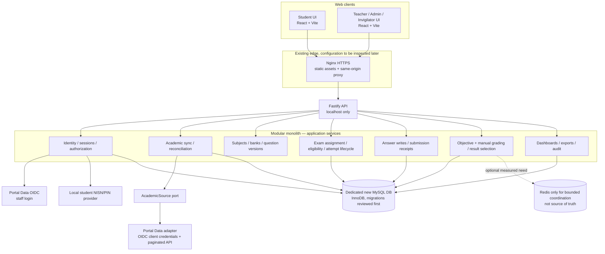
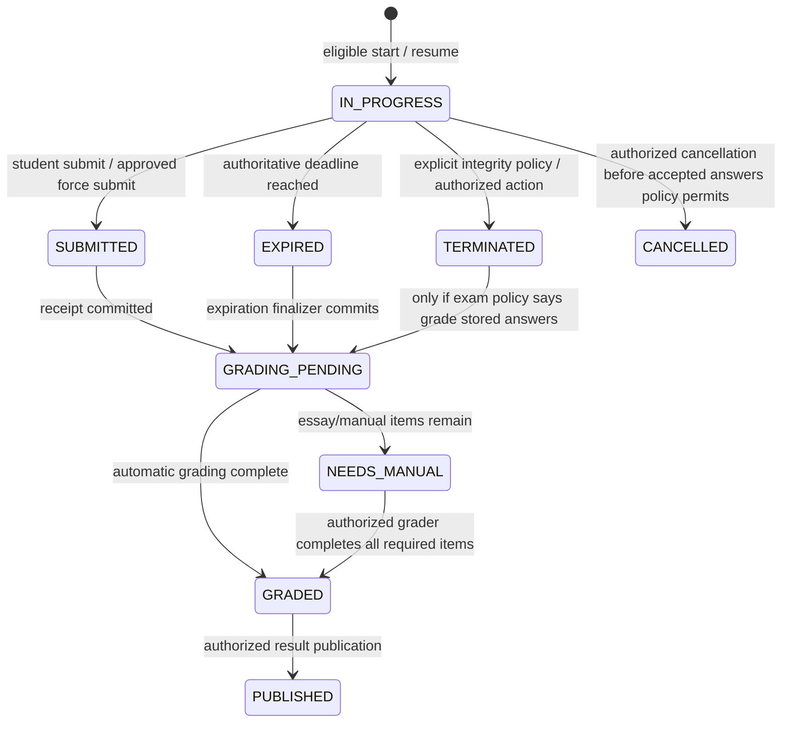

# Arena CBT — Phase 2 Architecture and Database Design

**Status:** proposal for review. This is documentation only. No application code, migration, database, production service, or deployment was changed by this design step.

**Version assumptions:** MySQL 8.0+ with InnoDB, enforced `CHECK` constraints, JSON columns, and generated columns. Exact deployed versions are unverified. All timestamps are UTC in storage (`DATETIME(3)`); the UI displays `Asia/Jakarta`.

## 1. Requirements and assumptions

### Approved by the requester

- Keep Fastify, strict TypeScript, React, Vite, and MySQL.
- Isolate the new database from the current Arena and legacy CBT databases.
- Use the verified Portal Data MAN 1 API as the initial academic provider through a replaceable adapter. Do not assert that Portal Data and SIPADU are the same API.
- Retain NISN + local Arena PIN for students; store only a one-way password hash. Retain Portal Data OIDC for teachers and employees.
- Preserve main, make-up, remedial, and other approved attempts without replacing previous answers/results.
- Server is authoritative for eligibility, exam state, deadlines, answer validation, submission, and grading.
- Protect answer integrity, idempotency, recovery, and access control before optimizing throughput.
- Preserve every pre-existing local change. Do not edit application code, run migrations, alter databases, delete files, or deploy during this phase.

### Assumptions requiring review or verification

| ID | Assumption / proposal | Why it matters |
|---|---|---|
| A1 | New logical database name is `arena_cbt_next`; its availability is unknown and must be inspected before use. | Isolation and avoiding accidental reuse of the current Arena database. |
| A2 | The schema targets MySQL 8.0+ / InnoDB. | CHECK constraints, generated-column uniqueness, locking behavior, and JSON support. |
| A3 | One `exam_assignment` is the unit of scheduling, eligibility, result policy, and attempt uniqueness. | Defines which event a “one primary attempt” rule applies to. |
| A4 | Default result selection is `PRIMARY_ONLY`; an exam may explicitly select `LATEST_APPROVED` or `HIGHEST_APPROVED`. | Avoids silently choosing a different score when remedial attempts exist. |
| A5 | Additional attempt kinds are `MAKEUP`, `REMEDIAL`, and `RETAKE`; an authorized person creates a single-use authorization with reason and time window. | Requires a consistent approval and retry policy. |
| A6 | Objective grading can run in a bounded MySQL-backed job worker; manual grading is represented as a separate pending state. | Avoids requiring a new message broker before workload measurements. |
| A7 | Student pending answer recovery may use short-lived IndexedDB records containing answer payloads only, not question content; records clear after acknowledgement, submit, expiry, or logout. | Improves refresh/offline recovery but exposes answer data to same-origin script compromise. Approval required. |
| A8 | Local administrator accounts remain possible; teacher/employee identities are OIDC-linked. | The supplied decisions specify teacher/employee OIDC but not administrator authentication. |
| A9 | Only a complete stable Portal Data snapshot with zero rejected rows can mark absent active-only records inactive while retaining them and all historical links. | Source endpoints return active records only; absence is meaningful only after a complete scan with stable before/after revisions. |
| A10 | The current Portal Data API supplies only each student's current enrollment in the student payload. | Historical class enrollment requires a source API capability or a clearly limited local observation history. |
| A11 | Initial question types follow existing Arena support: single choice, multi-select, and short answer. Essay/manual grading is an extension until approved. | Controls grading schema, API, and teacher workflow. |
| A12 | Proposed initial performance objectives: <1% HTTP errors, p95 under 500 ms on lightweight operations, and zero lost acknowledged answer writes. These are test gates, not guarantees. | Must be agreed before load tests and may need adjustment to school network realities. |

### Existing API facts verified in repository

Portal Data's `api/v1/integration/cbt` routes are protected with a service token using OIDC `client_credentials` and `portal_data.read`, and are throttled to 120 requests/minute. Verified reads are `revisions`, `academic-years`, `semesters`, `students`, `teachers`, `employees`, and `classes`. Student/class/staff list endpoints are paginated; student data includes a current enrollment. Responses use `{success,message,data}`. For paginated methods, Laravel serializes paginator keys inside `data`: `data.data[]`, `data.current_page`, `data.last_page`, `data.per_page`, and `data.total`. The current student/class endpoints filter to active records. No separate SIPADU contract has been established.

The existing Arena integration source is useful evidence, not the new implementation specification. The source API's enrollment history, deletion/tombstone semantics, and exact continuity guarantees remain to be confirmed with the Portal Data owner.

## 2. Module architecture



**Boundaries:** HTTP controllers perform parsing, authentication, authorization, and response mapping. Application services own exam policy and state transitions. Repositories own SQL and transaction boundaries. `AcademicSource` owns provider-specific authentication, payload parsing, pagination, and revisions. No microservices or new infrastructure are proposed initially.

## 3. Database design and constraints

The full conceptual ERD is in [erd-draft.mmd](./erd-draft.mmd). The table catalog below is the proposed logical schema; names, lengths, and indexes still require review against query plans and installed MySQL version. `BIGINT UNSIGNED` identifiers are internal. External IDs are strings scoped by provider.

All tables use InnoDB, `utf8mb4`, and `created_at DATETIME(3)` / `updated_at DATETIME(3)` where mutable. Append-only history tables omit update timestamps unless noted. FK deletes default to `RESTRICT`; only owned child rows such as options of an unpublished draft may cascade. Historical academic, exam, attempt, answer, result, and audit rows are retained; do not hard-delete them.

### Academic source and synchronization tables

| Table | Columns (type; PK marked `PK`) | Unique/indexes | Foreign keys / rules |
|---|---|---|---|
| `academic_sources` | `id BIGINT UNSIGNED PK`, `provider_key VARCHAR(64)`, `display_name VARCHAR(120)`, `status ENUM('ACTIVE','DISABLED')`, timestamps | `UNIQUE(provider_key)` | Stable adapter identity; never put credentials here. |
| `academic_sync_runs` | `id BIGINT UNSIGNED PK`, `source_id BIGINT UNSIGNED`, `entity_type VARCHAR(32)`, `status ENUM('RUNNING','SUCCESS','PARTIAL','FAILED','ABORTED')`, `source_revision_before CHAR(64) NULL`, `source_revision_after CHAR(64) NULL`, `page_count INT UNSIGNED`, `records_seen INT UNSIGNED`, `inserted_count INT UNSIGNED`, `updated_count INT UNSIGNED`, `deactivated_count INT UNSIGNED`, `rejected_count INT UNSIGNED`, `started_at DATETIME(3)`, `finished_at DATETIME(3) NULL`, `initiated_by_user_id BIGINT UNSIGNED NULL`, `error_summary VARCHAR(1000) NULL`, timestamps | `(source_id,entity_type,started_at)`, `(status,started_at)` | `source_id → academic_sources`; actor → `users` with `SET NULL`. Never store tokens or raw personal payloads in errors. |
| `academic_sync_issues` | `id BIGINT UNSIGNED PK`, `sync_run_id BIGINT UNSIGNED`, `source_record_key VARCHAR(128) NULL`, `severity ENUM('WARNING','ERROR')`, `field_name VARCHAR(100) NULL`, `safe_message VARCHAR(500)`, `created_at DATETIME(3)` | `(sync_run_id,id)`, `(source_record_key)` | `sync_run_id → academic_sync_runs ON DELETE CASCADE`; no PIN or unnecessary student data in message. |

### Academic reference tables

| Table | Columns | Unique/indexes | Foreign keys / rules |
|---|---|---|---|
| `students` | `id BIGINT UNSIGNED PK`, `source_id BIGINT UNSIGNED`, `source_student_id VARCHAR(64)`, `nisn VARCHAR(20)`, `full_name VARCHAR(191)`, `source_status VARCHAR(32)`, `is_active BOOLEAN`, `last_seen_sync_id BIGINT UNSIGNED NULL`, timestamps | `UNIQUE(source_id,source_student_id)`, proposed `UNIQUE(nisn)`, `(is_active,nisn)`, `(full_name,id)` | `source_id → academic_sources`; last sync → `academic_sync_runs SET NULL`. NISN uniqueness must be confirmed against source data; collisions are quarantined, not merged. |
| `teachers` | `id BIGINT UNSIGNED PK`, `source_id BIGINT UNSIGNED`, `source_teacher_id VARCHAR(64)`, `nip VARCHAR(32) NULL`, `nuptk VARCHAR(32) NULL`, `full_name VARCHAR(191)`, `source_status VARCHAR(32)`, `is_active BOOLEAN`, `last_seen_sync_id BIGINT UNSIGNED NULL`, timestamps | `UNIQUE(source_id,source_teacher_id)`, indexes on `nip`, `nuptk`, `(is_active,full_name)` | Source/sync FKs as above. NIP/NUPTK are not assumed globally unique unless source confirms. |
| `employees` | `id BIGINT UNSIGNED PK`, `source_id BIGINT UNSIGNED`, `source_employee_id VARCHAR(64)`, `nip VARCHAR(32) NULL`, `employee_number VARCHAR(64) NULL`, `full_name VARCHAR(191)`, `position VARCHAR(120) NULL`, `source_status VARCHAR(32)`, `is_active BOOLEAN`, `last_seen_sync_id BIGINT UNSIGNED NULL`, timestamps | `UNIQUE(source_id,source_employee_id)`, indexes on `nip`, `employee_number`, `(is_active,full_name)` | Source/sync FKs. |
| `academic_years` | `id BIGINT UNSIGNED PK`, `source_id BIGINT UNSIGNED`, `source_academic_year_id VARCHAR(64)`, `name VARCHAR(40)`, `is_active BOOLEAN`, `last_seen_sync_id BIGINT UNSIGNED NULL`, timestamps | `UNIQUE(source_id,source_academic_year_id)`, `(is_active,name)` | Source/sync FKs. |
| `semesters` | `id BIGINT UNSIGNED PK`, `source_id BIGINT UNSIGNED`, `source_semester_id VARCHAR(64)`, `academic_year_id BIGINT UNSIGNED`, `semester_type ENUM('ODD','EVEN')`, `name VARCHAR(80) NULL`, `is_active BOOLEAN`, `last_seen_sync_id BIGINT UNSIGNED NULL`, timestamps | `UNIQUE(source_id,source_semester_id)`, `UNIQUE(academic_year_id,semester_type)`, `(is_active,academic_year_id)` | `academic_year_id → academic_years`; source/sync FKs. If Portal Data allows repeated semester type per year, revise uniqueness based on its actual contract. |
| `classes` | `id BIGINT UNSIGNED PK`, `source_id BIGINT UNSIGNED`, `source_class_id VARCHAR(64)`, `academic_year_id BIGINT UNSIGNED NULL`, `code VARCHAR(64) NULL`, `name VARCHAR(120)`, `grade VARCHAR(12) NULL`, `source_status VARCHAR(32)`, `is_active BOOLEAN`, `last_seen_sync_id BIGINT UNSIGNED NULL`, timestamps | `UNIQUE(source_id,source_class_id)`, `(academic_year_id,grade,is_active)`, `(name,id)` | `academic_year_id → academic_years SET NULL`; source/sync FKs. |
| `student_class_enrollments` | `id BIGINT UNSIGNED PK`, `source_id BIGINT UNSIGNED`, `source_enrollment_id VARCHAR(64) NULL`, `student_id BIGINT UNSIGNED`, `class_id BIGINT UNSIGNED`, `academic_year_id BIGINT UNSIGNED`, `semester_id BIGINT UNSIGNED`, `status ENUM('ACTIVE','INACTIVE','UNKNOWN')`, `first_observed_at DATETIME(3)`, `last_observed_at DATETIME(3)`, `valid_from DATE NULL`, `valid_to DATE NULL`, timestamps | `UNIQUE(student_id,semester_id,class_id)`, `(class_id,semester_id,status,student_id)`, `(student_id,academic_year_id,semester_id)` | Source/student/class/year/semester FKs, all `RESTRICT`. Keep prior class rows when a current enrollment changes; source currently exposes current enrollment rather than enrollment history, so valid dates remain NULL unless authoritative dates become available. |

### Identity and authorization tables

| Table | Columns | Unique/indexes | Foreign keys / rules |
|---|---|---|---|
| `users` | `id BIGINT UNSIGNED PK`, `username VARCHAR(100) NULL`, `display_name VARCHAR(191)`, `password_hash VARCHAR(255) NULL`, `oidc_issuer VARCHAR(255) NULL`, `oidc_subject VARCHAR(255) NULL`, `teacher_id BIGINT UNSIGNED NULL`, `employee_id BIGINT UNSIGNED NULL`, `status ENUM('ACTIVE','DISABLED')`, `last_login_at DATETIME(3) NULL`, timestamps | `UNIQUE(username)`, `UNIQUE(oidc_issuer,oidc_subject)`, `UNIQUE(teacher_id)`, `UNIQUE(employee_id)`, `(status,display_name)` | Teacher/employee FKs `RESTRICT`; CHECK exactly one staff link at most, and OIDC identity pair is both null or both non-null. Password hash is only for approved local admin account types. |
| `roles` | `id SMALLINT UNSIGNED PK`, `role_key VARCHAR(32)`, `description VARCHAR(160)` | `UNIQUE(role_key)` | Seed controlled role names; permissions still checked on server. |
| `user_roles` | `user_id BIGINT UNSIGNED`, `role_id SMALLINT UNSIGNED`, `granted_by BIGINT UNSIGNED NULL`, `created_at DATETIME(3)` | `PK(user_id,role_id)`, `(role_id,user_id)` | User/role FKs `RESTRICT`; grantor → users `SET NULL`. |
| `student_credentials` | `student_id BIGINT UNSIGNED PK`, `pin_hash VARCHAR(255)`, `hash_algorithm VARCHAR(24)`, `changed_at DATETIME(3)`, `changed_by_user_id BIGINT UNSIGNED NULL`, `failed_count SMALLINT UNSIGNED`, `throttled_until DATETIME(3) NULL`, timestamps | `(throttled_until)` | Student FK `RESTRICT`; changed_by → users `SET NULL`. No plaintext PIN column. Failure counters are bounded and use progressive delay, not permanent lockout. |
| `student_sessions` | `id BIGINT UNSIGNED PK`, `student_id BIGINT UNSIGNED`, `token_hash BINARY(32)`, `csrf_hash BINARY(32)`, `created_at DATETIME(3)`, `last_seen_at DATETIME(3)`, `expires_at DATETIME(3)`, `revoked_at DATETIME(3) NULL`, `revoke_reason VARCHAR(80) NULL`, `user_agent_hash BINARY(32) NULL` | `UNIQUE(token_hash)`, `(student_id,revoked_at,expires_at)`, `(expires_at)` | Student FK `RESTRICT`; session tokens are random opaque values, only hash stored. |
| `user_sessions` | Same session columns, with `user_id BIGINT UNSIGNED` | `UNIQUE(token_hash)`, `(user_id,revoked_at,expires_at)`, `(expires_at)` | User FK `RESTRICT`; supports staff logout/revocation. |

### Subjects, questions, exams, and assignments

| Table | Columns | Unique/indexes | Foreign keys / rules |
|---|---|---|---|
| `subjects` | `id BIGINT UNSIGNED PK`, `code VARCHAR(40) NULL`, `name VARCHAR(120)`, `status ENUM('ACTIVE','INACTIVE')`, timestamps | proposed `UNIQUE(code)`, `(status,name)` | Subject code uniqueness depends on administrative policy. |
| `question_banks` | `id BIGINT UNSIGNED PK`, `subject_id BIGINT UNSIGNED`, `name VARCHAR(160)`, `description TEXT NULL`, `owner_user_id BIGINT UNSIGNED`, `status ENUM('ACTIVE','ARCHIVED')`, timestamps | `(subject_id,status,name)`, `(owner_user_id,status)` | Subject/owner FKs `RESTRICT`. Ownership is not itself permission: service checks authorized roles/assignments. |
| `questions` | `id BIGINT UNSIGNED PK`, `question_bank_id BIGINT UNSIGNED`, `question_type ENUM('SINGLE_CHOICE','MULTI_SELECT','SHORT_ANSWER','ESSAY')`, `status ENUM('ACTIVE','ARCHIVED')`, `created_by BIGINT UNSIGNED`, timestamps | `(question_bank_id,status,id)` | Bank/creator FKs `RESTRICT`. |
| `question_versions` | `id BIGINT UNSIGNED PK`, `question_id BIGINT UNSIGNED`, `version_no INT UNSIGNED`, `prompt_json JSON`, `grading_config_json JSON`, `explanation_json JSON NULL`, `created_by BIGINT UNSIGNED`, `created_at DATETIME(3)` | `UNIQUE(question_id,version_no)`, `(question_id,created_at)` | Question/creator FKs `RESTRICT`. Immutable after referenced by a published assignment. Grading config is private. |
| `question_options` | `id BIGINT UNSIGNED PK`, `question_version_id BIGINT UNSIGNED`, `option_key VARCHAR(8)`, `content_json JSON`, `is_correct BOOLEAN`, `display_order SMALLINT UNSIGNED` | `UNIQUE(question_version_id,option_key)`, `(question_version_id,display_order)` | Version FK `RESTRICT`. Student query projection excludes `is_correct`. |
| `exams` | `id BIGINT UNSIGNED PK`, `public_id BINARY(16)`, `title VARCHAR(191)`, `subject_id BIGINT UNSIGNED`, `instructions_json JSON NULL`, `duration_seconds INT UNSIGNED`, `created_by BIGINT UNSIGNED`, `status ENUM('DRAFT','PUBLISHED','PAUSED','CLOSED','ARCHIVED')`, timestamps | `UNIQUE(public_id)`, `(subject_id,status,updated_at)`, `(created_by,status)` | Subject/creator FKs `RESTRICT`; positive duration CHECK. |
| `exam_policies` | `exam_id BIGINT UNSIGNED PK`, `result_selection ENUM('PRIMARY_ONLY','LATEST_APPROVED','HIGHEST_APPROVED')`, `allow_makeup BOOLEAN`, `allow_remedial BOOLEAN`, `allow_retake BOOLEAN`, `max_extra_attempts SMALLINT UNSIGNED`, `randomize_questions BOOLEAN`, `randomize_options BOOLEAN`, `show_score_after_publication BOOLEAN`, `policy_version INT UNSIGNED`, `updated_by BIGINT UNSIGNED`, `updated_at DATETIME(3)` | — | Exam/user FKs `RESTRICT`; policy is snapshotted into assignment/attempt at publication. Defaults remain subject to approval. |
| `exam_assignments` | `id BIGINT UNSIGNED PK`, `public_id BINARY(16)`, `exam_id BIGINT UNSIGNED`, `academic_year_id BIGINT UNSIGNED`, `semester_id BIGINT UNSIGNED`, `title_snapshot VARCHAR(191)`, `starts_at DATETIME(3)`, `ends_at DATETIME(3)`, `duration_seconds INT UNSIGNED`, `late_request_policy ENUM('RECEIVED_BEFORE_DEADLINE','STARTED_BEFORE_DEADLINE')`, `result_selection ENUM('PRIMARY_ONLY','LATEST_APPROVED','HIGHEST_APPROVED')`, `policy_snapshot JSON`, `status ENUM('DRAFT','SCHEDULED','OPEN','PAUSED','CLOSED','CANCELLED','ARCHIVED')`, `published_at DATETIME(3) NULL`, `published_by BIGINT UNSIGNED NULL`, timestamps | `UNIQUE(public_id)`, `(status,starts_at,ends_at)`, `(exam_id,semester_id,status)` | Exam/year/semester FKs `RESTRICT`; publish actor → users `SET NULL`; end > start CHECK. Schedule status is server-controlled; time window is separately validated. |
| `exam_assignment_classes` | `assignment_id BIGINT UNSIGNED`, `class_id BIGINT UNSIGNED`, `created_at DATETIME(3)` | `PK(assignment_id,class_id)`, `(class_id,assignment_id)` | Assignment/class FKs `RESTRICT`. |
| `exam_assignment_students` | `assignment_id BIGINT UNSIGNED`, `student_id BIGINT UNSIGNED`, `eligibility_reason VARCHAR(80) NULL`, `created_at DATETIME(3)` | `PK(assignment_id,student_id)`, `(student_id,assignment_id)` | Assignment/student FKs `RESTRICT`. Empty class + student target sets means no eligible participants only if that policy is explicitly selected; proposed default is publication validation rejects empty eligibility. |
| `exam_assignment_staff` | `assignment_id BIGINT UNSIGNED`, `user_id BIGINT UNSIGNED`, `duty_role ENUM('AUTHOR','GRADER','INVIGILATOR')`, `created_at DATETIME(3)` | `PK(assignment_id,user_id,duty_role)`, `(user_id,duty_role,assignment_id)` | Assignment/user FKs `RESTRICT`. This grants bounded assignment scope; platform ADMIN permissions remain separate. |
| `exam_questions` | `id BIGINT UNSIGNED PK`, `assignment_id BIGINT UNSIGNED`, `question_version_id BIGINT UNSIGNED`, `points DECIMAL(8,2)`, `display_order INT UNSIGNED`, `created_at DATETIME(3)` | `UNIQUE(assignment_id,display_order)`, `UNIQUE(assignment_id,question_version_id)`, `(question_version_id,assignment_id)` | Assignment/version FKs `RESTRICT`; points > 0 CHECK. Published rows immutable. |

### Attempts, answers, grading, and audit

| Table | Columns | Unique/indexes | Foreign keys / rules |
|---|---|---|---|
| `attempt_authorizations` | `id BIGINT UNSIGNED PK`, `assignment_id BIGINT UNSIGNED`, `student_id BIGINT UNSIGNED`, `parent_attempt_id BIGINT UNSIGNED NULL`, `attempt_kind ENUM('MAKEUP','REMEDIAL','RETAKE')`, `reason VARCHAR(1000)`, `valid_from DATETIME(3)`, `valid_until DATETIME(3)`, `deadline_at DATETIME(3)`, `approved_by_user_id BIGINT UNSIGNED`, `created_at DATETIME(3)`, `revoked_at DATETIME(3) NULL` | `(assignment_id,student_id,revoked_at,valid_from)`, `(approved_by_user_id,created_at)` | Assignment/student/parent/user FKs `RESTRICT`; valid window and deadline CHECK. Single use is enforced by `UNIQUE(exam_attempts.authorization_id)`; approval is immutable, revocation is audited. |
| `exam_attempts` | `id BIGINT UNSIGNED PK`, `public_id BINARY(16)`, `assignment_id BIGINT UNSIGNED`, `student_id BIGINT UNSIGNED`, `attempt_kind ENUM('MAIN','MAKEUP','REMEDIAL','RETAKE')`, `authorization_id BIGINT UNSIGNED NULL`, `parent_attempt_id BIGINT UNSIGNED NULL`, `status ENUM('IN_PROGRESS','SUBMITTED','EXPIRED','TERMINATED','CANCELLED')`, `started_at DATETIME(3)`, `deadline_at DATETIME(3)`, `submitted_at DATETIME(3) NULL`, `terminal_reason VARCHAR(160) NULL`, `question_order JSON`, `option_order JSON`, `policy_snapshot JSON`, `created_at DATETIME(3)`, `updated_at DATETIME(3)`, generated nullable `main_student_guard BIGINT UNSIGNED` = student ID only for MAIN | `UNIQUE(public_id)`, `UNIQUE(assignment_id,main_student_guard)`, `UNIQUE(authorization_id)`, `(student_id,assignment_id,created_at)`, `(assignment_id,status,deadline_at)`, `(status,deadline_at)` | Assignment/student FKs `RESTRICT`; authorization/parent self-FKs `RESTRICT`; CHECK MAIN iff authorization NULL, extra attempt iff authorization non-NULL; deadline after start. Generated unique key permits only one MAIN while allowing multiple authorized extras. Extra-attempt count is checked while locking the assignment/student scope in one transaction. |
| `attempt_question_snapshots` | `id BIGINT UNSIGNED PK`, `attempt_id BIGINT UNSIGNED`, `exam_question_id BIGINT UNSIGNED`, `question_type VARCHAR(24)`, `student_content_json JSON`, `private_grading_json JSON`, `option_order JSON`, `points DECIMAL(8,2)`, `created_at DATETIME(3)` | `UNIQUE(attempt_id,exam_question_id)`, `(attempt_id,id)` | Attempt/exam question FKs `RESTRICT`. Student delivery reads only `student_content_json`; grading service alone reads private grading data. |
| `answers` | `id BIGINT UNSIGNED PK`, `attempt_id BIGINT UNSIGNED`, `attempt_question_snapshot_id BIGINT UNSIGNED`, `answer_json JSON NULL`, `is_flagged BOOLEAN`, `revision BIGINT UNSIGNED`, `last_mutation_id BINARY(16)`, `saved_at DATETIME(3)` | `UNIQUE(attempt_question_snapshot_id)`, `(attempt_id,saved_at)` | Attempt/snapshot FKs `RESTRICT`; revisions increase only under attempt lock. Empty answer is explicit JSON null. |
| `answer_write_receipts` | `id BIGINT UNSIGNED PK`, `attempt_id BIGINT UNSIGNED`, `attempt_question_snapshot_id BIGINT UNSIGNED`, `mutation_id BINARY(16)`, `request_hash BINARY(32)`, `result_revision BIGINT UNSIGNED`, `result_code ENUM('APPLIED','DUPLICATE')`, `created_at DATETIME(3)` | `UNIQUE(attempt_id,mutation_id)`, `(attempt_id,attempt_question_snapshot_id,created_at)` | Attempt/question FKs `RESTRICT`. Insert receipt and update answer in the same transaction. Retention period must cover attempt recovery/audit policy. |
| `submission_receipts` | `id BIGINT UNSIGNED PK`, `attempt_id BIGINT UNSIGNED`, `idempotency_key BINARY(16)`, `answer_manifest_hash BINARY(32)`, `submitted_at DATETIME(3)`, `response_snapshot_json JSON`, `created_at DATETIME(3)` | `UNIQUE(attempt_id)`, `UNIQUE(idempotency_key)` | Attempt FK `RESTRICT`. Exactly one durable receipt/effect per attempt; retries return this receipt. |
| `grading_jobs` | `id BIGINT UNSIGNED PK`, `attempt_id BIGINT UNSIGNED`, `status ENUM('PENDING','RUNNING','RETRY','DONE','FAILED')`, `attempt_count SMALLINT UNSIGNED`, `available_at DATETIME(3)`, `lease_until DATETIME(3) NULL`, `last_error_safe VARCHAR(500) NULL`, timestamps | `UNIQUE(attempt_id)`, `(status,available_at,id)`, `(lease_until)` | Attempt FK `RESTRICT`; bounded claim batch and retry count, lease reclaimed after worker failure. |
| `exam_results` | `id BIGINT UNSIGNED PK`, `attempt_id BIGINT UNSIGNED`, `grading_status ENUM('PENDING','NEEDS_MANUAL','GRADED','FAILED')`, `earned_points DECIMAL(10,2) NULL`, `maximum_points DECIMAL(10,2)`, `score DECIMAL(7,3) NULL`, `graded_at DATETIME(3) NULL`, `published_at DATETIME(3) NULL`, timestamps | `UNIQUE(attempt_id)`, `(grading_status,published_at)` | Attempt FK `RESTRICT`; scores server-calculated; publication is a separate policy action. |
| `exam_result_items` | `id BIGINT UNSIGNED PK`, `exam_result_id BIGINT UNSIGNED`, `attempt_question_snapshot_id BIGINT UNSIGNED`, `answer_snapshot_json JSON NULL`, `earned_points DECIMAL(8,2) NULL`, `grading_status ENUM('AUTO_GRADED','NEEDS_MANUAL','MANUALLY_GRADED')`, `feedback_json JSON NULL`, `graded_by_user_id BIGINT UNSIGNED NULL`, `graded_at DATETIME(3) NULL` | `UNIQUE(exam_result_id,attempt_question_snapshot_id)`, `(grading_status,graded_at)` | Result/snapshot/user FKs `RESTRICT`/`SET NULL`. Answer content access restricted and retention governed. |
| `selected_exam_results` | `id BIGINT UNSIGNED PK`, `assignment_id BIGINT UNSIGNED`, `student_id BIGINT UNSIGNED`, `attempt_id BIGINT UNSIGNED`, `selection_policy ENUM('PRIMARY_ONLY','LATEST_APPROVED','HIGHEST_APPROVED')`, `selected_at DATETIME(3)`, `selected_by_user_id BIGINT UNSIGNED NULL` | `UNIQUE(assignment_id,student_id)`, `UNIQUE(attempt_id)`, `(assignment_id,selected_at)` | Assignment/student/attempt/user FKs `RESTRICT`; selection is recomputed only through an authorized policy action and audited. For score ties under HIGHEST_APPROVED, proposed tie-break is earlier submission, then lower attempt ID. |
| `audit_logs` | `id BIGINT UNSIGNED PK`, `actor_user_id BIGINT UNSIGNED NULL`, `actor_student_id BIGINT UNSIGNED NULL`, `action VARCHAR(80)`, `entity_type VARCHAR(60)`, `entity_id VARCHAR(80)`, `request_id BINARY(16) NULL`, `safe_metadata_json JSON NULL`, `created_at DATETIME(3)` | `(created_at,id)`, `(entity_type,entity_id,created_at)`, `(actor_user_id,created_at)`, `(actor_student_id,created_at)` | Actor FKs `SET NULL`; CHECK at most one actor; append-only permissions. Never include secrets, PINs, raw tokens, answer bodies, or answer keys. |

**Foreign-key/index policy:** the composite indexes shown correspond to access paths: student login/eligibility, class-to-student assignment, available assignment listing, attempt resume, expiration finalization, answer uniqueness, submission idempotency, sync history, and audit lookup. During implementation, validate with `EXPLAIN ANALYZE` on representative data and remove indexes that do not improve real queries. Avoid adding every FK column index twice when a leading composite index already covers it.

## 4. Exam and attempt state machines

### Exam authoring and assignment

`exams`: `DRAFT → PUBLISHED → CLOSED → ARCHIVED`; `PUBLISHED → PAUSED → PUBLISHED`; `PUBLISHED/PAUSED → CANCELLED` only via explicit authorized cancellation and policy. Publishing validates at least one question, positive duration, valid schedule, approved result policy, and eligible targets. A published assignment snapshots the exam/question versions and relevant policy. Editing a referenced version creates a new version or assignment; it never mutates an active attempt's snapshot.

`exam_assignments`: `DRAFT → SCHEDULED → OPEN → CLOSED → ARCHIVED`, with `SCHEDULED/OPEN → PAUSED → SCHEDULED/OPEN` and `DRAFT/SCHEDULED/OPEN/PAUSED → CANCELLED` by authorized admin under audit. `OPEN` is not trusted from client time: the API also checks `starts_at <= UTC_TIMESTAMP(3) < ends_at` and status on every start. Pausing behavior for already-running attempts requires approval (proposed default: block new starts, let running attempts continue to their existing deadline).

### Attempt and grading



Attempt terminal states are immutable. The separately tracked grading state can progress, retry, or await manual review; it does not reopen answer writes. Whether TERMINATED attempts are automatically graded or excluded remains an approval decision. Cancellation after accepted answers is disabled by default in this proposal.

## 5. Autosave, recovery, submission, and grading

### Autosave protocol

1. Client changes one answer and creates one stable UUID `mutation_id`; it queues only the latest unsent draft per question. Debounce approximately 300–700 ms (configurable) and send changes, not unchanged answers.
2. `PUT /api/v1/student/attempts/{attemptId}/answers/{attemptQuestionId}` includes `mutation_id`, `base_revision`, `answer`, and `is_flagged`. Use a per-question revision. Do not batch every answer on every poll.
3. Server authenticates the student, checks ownership, assignment/attempt state, deadline using DB UTC, question membership, answer schema, and CSRF. Inside a transaction, lock the attempt and answer row, check idempotency receipt, require the expected revision, validate option keys/text limits, write answer + incremented revision + receipt atomically, then commit.
4. A retry with the same mutation ID and same request hash returns the original revision/receipt. Same ID with different body returns `409`. A stale base revision returns `409` plus current revision; the client fetches server state and resolves explicitly rather than blindly overwriting it.
5. Network failures keep a bounded local queue, retry with exponential backoff + jitter (for example 0.5, 1, 2, 4 seconds, capped; finite attempts while online), and show `Belum tersimpan` until acknowledged. On reconnect, replay stable mutation IDs in order. Do not silently discard a failed answer.
6. UI shows per-attempt save status and last acknowledged server time. Use IndexedDB recovery only if A7 is approved; store pending answer payloads with short expiry, not question text/keys, and clear on acknowledgement/submit/logout.

### Final submission protocol

1. Client disables edits and drains all pending answer writes. It sends `POST /api/v1/student/attempts/{attemptId}/submit` with stable `Idempotency-Key` and an answer revision manifest for questions the client edited.
2. Server authenticates and verifies attempt ownership. In one transaction, locks the attempt, checks status and DB deadline, verifies the client manifest is not ahead of durable revisions, resolves final write conflicts, commits an immutable submission receipt, and transitions `IN_PROGRESS → SUBMITTED`. If a manifest revision is missing, return `409` with missing/current revisions and leave the attempt in progress; client must sync then retry.
3. A duplicate submission with the same key returns the stable receipt. A different-key duplicate against an already submitted attempt returns the existing receipt/status; it never creates another result. `GET .../submission` recovers after a lost HTTP response.
4. Grading job insert is in the same transaction as submit. Worker claims bounded batches with lease/row locking, computes from private attempt snapshots, upserts one result and one result item per attempt question, and marks job done in a transaction. Reprocessing yields the same score and no duplicate result. Manual items remain `NEEDS_MANUAL`; result publication is separate.

### Deadline semantics

Server DB UTC is authoritative. Proposed policy is request-received time: a save/submit is accepted only if the DB transaction observes `UTC_TIMESTAMP(3) < deadline_at`. This is simplest to enforce and prevents client clock manipulation, but students may be disadvantaged by delayed network packets. Alternative grace/in-flight policy requires explicit approval and a trustworthy server ingress timestamp. Expiration finalization is a recoverable bounded worker; requests also enforce expiry so worker downtime cannot extend the exam.

## 6. API contracts and access rules

All APIs use `/api/v1`, JSON, a stable error envelope `{error:{code,message,request_id,details?}}`, pagination with bounded `limit` and opaque/ID cursor where appropriate, and `Cache-Control: no-store` for auth/exam/private results. Request validation is strict. All cookie-authenticated mutations require CSRF. IDs are opaque public identifiers; every read/write also enforces object-level ownership/assignment, not merely role.

| Method + path | Access | Contract and critical checks |
|---|---|---|
| `POST /auth/student/login` | Public, account + IP/network throttled | `{nisn,pin}`; generic invalid-credential response; successful login sets opaque HttpOnly cookie; PIN never returned/logged. |
| `GET /auth/student/session` | Student session | Returns student display/academic context + CSRF token; checks student active/session expiry. |
| `POST /auth/logout` | Student or staff session + CSRF | Revokes server session and expires cookie. |
| `POST /auth/staff/oidc/start`, `GET /auth/staff/oidc/callback` | Public OIDC flow | Authorization code + PKCE, state/nonce/issuer/audience/signature validation; maps OIDC subject to enabled Arena role. |
| `GET /student/assignments` | Student | Only eligible assignments and that student's attempt/availability summary; no answer key. |
| `GET /student/assignments/{assignmentId}` | Student eligible | Instructions and server timing policy; no questions until a valid attempt. |
| `POST /student/assignments/{assignmentId}/attempts` | Student eligible | Idempotently create/resume one MAIN attempt; checks active student, class/student eligibility, schedule, status, prior terminal attempt, max attempts. |
| `GET /student/attempts/{attemptId}` | Owning student | Resume context, server time/deadline, question display content and saved answers; response allowlist excludes grading metadata. |
| `GET /student/attempts/{attemptId}/questions?cursor=&limit=` | Owning student | Bounded batch; order/options persisted per attempt; never returns correct keys or hidden explanations. |
| `PUT /student/attempts/{attemptId}/answers/{attemptQuestionId}` | Owning student + CSRF | Idempotent per mutation; expected revision; only IN_PROGRESS and before deadline. |
| `POST /student/attempts/{attemptId}/submit` | Owning student + CSRF | Idempotency key + final revision manifest; atomic durable receipt and transition. |
| `GET /student/attempts/{attemptId}/submission` | Owning student | Stable status/receipt after retry, reload, or lost response. |
| `GET /student/results` | Student | Only published selected result; policy is per assignment. |
| `GET /staff/subjects` | Teacher/admin | Only subjects available to the caller. |
| `GET,POST /staff/question-banks` | Teacher/admin | List/create within authorized subject scope; create validates ownership and subject assignment. |
| `GET,POST /staff/question-banks/{bankId}/questions` | Bank owner/assigned teacher/admin | List/create draft question; creation starts version 1 and validates type-specific grading config. |
| `POST /staff/questions/{questionId}/versions` | Bank owner/assigned teacher/admin | Creates immutable next version; cannot edit a version already used by a published assignment. |
| `GET /staff/exams/{examId}` | Author/assigned teacher/admin | Returns permitted draft/published exam config; grading keys require authoring permission. |
| `POST /staff/exams`, `PATCH /staff/exams/{id}` | Teacher authorized subject/assignment or admin | Draft validation; no editing snapshots used by started/published attempts. |
| `POST /staff/exams/{id}/publish` | Authorized teacher/admin | Snapshot versions/policies, validate eligibility, schedule and question list; audit. |
| `POST /staff/exams/{examId}/assignments` | Authorized teacher/admin | Creates scheduled delivery instance, target classes/students and policy snapshot; validate nonempty eligible audience and schedule. |
| `GET /staff/assignments/{assignmentId}` | Assigned teacher/admin/invigilator | Returns assignment configuration allowed by duty; omit grading keys unless authorized author/grader. |
| `POST /staff/assignments/{id}/attempt-authorizations` | Authorized teacher for assigned exam or admin | Student, kind, parent attempt, reason, validity window/deadline; audit. One-time token/authorization consumed atomically on start. |
| `GET /staff/assignments/{id}/attempts` | Authorized teacher/admin/invigilator assignment | Paginated aggregate/roster; restrict answer content and private grading fields by role. |
| `POST /staff/attempts/{id}/terminate` | Admin or explicitly authorized invigilator | Reason, policy check, audit; cannot erase responses. |
| `GET /staff/attempts/{id}/grading` | Assigned teacher/admin | Essay/submitted answers only for permitted assignment; log access if required. |
| `PUT /staff/attempts/{id}/grading-items/{itemId}` | Authorized grader + CSRF | Valid score bounds, reason/feedback, revision check, immutable grading event. |
| `POST /staff/assignments/{id}/publish-results` | Authorized teacher/admin | Applies approved selection policy; result becomes student-visible only after this action. |
| `POST /admin/academic-sync/{entityType}` | Admin + CSRF | Starts background serialized sync; returns `202` run ID, not a long-running HTTP pagination request. |
| `GET /admin/academic-sync/runs` and `GET /admin/academic-sync/runs/{id}` | Admin | Paginated sanitized status/count/issues; no credentials or bulk personal data. |
| `GET /admin/users` and `PATCH /admin/users/{id}/status` | Admin | Paginated account list; disable/re-enable revokes active sessions and is audited. |
| `GET /admin/health`, `GET /health/live`, `GET /health/ready` | Admin / internal health | No secret/config leaks; readiness checks DB and configured dependencies with bounded timeout. |

**Role model proposal:** admin has platform scope; teacher is limited to owned/assigned subjects, exams, and classes; invigilator can monitor/terminate only explicitly assigned active sessions and cannot read answer keys or grade; student can access only own identity, assignment, attempt, answers, receipt, and published result. Any exceptional permission is explicit and audited. Exact invigilator scope requires approval.

**Representative write contracts:**

```http
PUT /api/v1/student/attempts/{attemptId}/answers/{attemptQuestionId}
Content-Type: application/json
{
  "mutation_id": "UUID",
  "base_revision": 4,
  "answer": {"selected": ["B"], "text": null},
  "is_flagged": false
}
```

Success returns `{ "attempt_question_id": "…", "revision": 5, "saved_at": "UTC timestamp", "duplicate": false }`. A replay of the same mutation and body returns the same committed revision with `duplicate:true`. Reusing the ID with a different request hash is `409 IDEMPOTENCY_KEY_REUSED`. A stale revision is `409 ANSWER_REVISION_CONFLICT` with the durable current revision; it is never an implicit overwrite.

```http
POST /api/v1/student/attempts/{attemptId}/submit
Content-Type: application/json
Idempotency-Key: UUID
{
  "final_revisions": [
    {"attempt_question_id": "…", "revision": 5}
  ]
}
```

Success returns a stable `{attempt_id, receipt_id, status, submitted_at}`. A missing durable revision is `409 ANSWERS_NOT_DURABLE` with the mismatches and no state transition. A deadline/state/ownership mismatch is a specific `409`, `403`, or `404`; invalid payload is `422`; throttled requests are `429`; unavailable database is `503`. Error messages do not reveal another student's attempt existence.

## 7. Portal Data synchronization strategy

1. `AcademicSource` exposes validated methods for revision fetch and paginated entity streams. `PortalDataAdapter` owns token acquisition/cache, endpoints, response decoding, and field mapping. A future SIPADU adapter can implement the same port without changing exam/auth modules.
2. Get an OAuth service token using `client_credentials` + `portal_data.read`; keep it in process memory only, refresh before expiry, retry once on 401. Never log token, secret, or full response bodies.
3. Before fetching, read revision for entity type. Fetch each page with capped `per_page` (source maximum 200) and validate success, expected shape, page progression, stable total/page count, unique source IDs, and record schema. Stop only from verified pagination metadata; enforce a maximum page count and run deadline.
4. Transform/validate into normalized rows; upsert in bounded batches/transactions using `(source_id,source_record_id)` as idempotency key. Record inserted/updated/rejected counts. Per-row bad data is quarantined with sanitized field errors; systemic invalid payload aborts the run.
5. Read revision again. If it changed, mark the run `ABORTED/RETRY` and do not reconcile missing records. Only a stable complete scan with zero rejected rows may mark absent records inactive (`is_active=false`); retain them and never delete. Any rejected row, pagination gap, duplicate source ID, source revision change, or suspicious count delta suppresses deactivation and requires repair/retry. Reconciliation is type-scoped and serialized by source/entity.
6. Portal Data currently returns active-only student/staff/class lists. Thus only a *complete and stable* snapshot may infer inactive-by-absence; sync failure, pagination gap, duplicate IDs, changing revision, or suspicious count delta must never deactivate. Threshold (for example >10% missing) pauses reconciliation and requires admin confirmation.
7. Use bounded retry with exponential backoff/jitter on network errors, 429 honoring `Retry-After`, and transient 5xx. Do not retry 4xx payload errors indefinitely. One lock per source/entity prevents overlap; lock has lease/expiry and run recovery after process restart.
8. Manual run and scheduled run use same service. Schedule outside configured exam windows; no full sync from student endpoints. Retain sync status, times, revisions, counts, sanitized errors, and last-success marker. Provide dry-run/count preview and admin reconciliation for suspicious cases.
9. Data source contract gap: `students` gives current enrollment, not full enrollment history. Until Portal Data confirms a period-history endpoint, store observed current enrollment with `observed_at`, use it for current eligibility, and snapshot class/semester on each exam assignment/attempt. Do not claim full historical class reconstruction.

## 8. Test, security, and concurrency validation

### Correctness and security test plan

- Unit: state-machine transitions, policy selection, attempt authorization, deadline semantics, answer schema/scoring, stable random ordering, sync transforms/revision comparison.
- Database integration: unique MAIN attempt under concurrent starts; authorization consumed once; answer+receipt atomicity; duplicate mutation same body; mutation ID with changed body rejected; stale/out-of-order save rejected; submit vs save race; submit idempotency; grading idempotency; no hard-delete of history; correct FK/delete policy.
- API authorization: student A cannot read/write student B's attempt; teacher cannot access unassigned exam; invigilator cannot retrieve answer key/grade; unpublished results hidden; CSRF required; OIDC issuer/audience/nonce/state/signature checks; disabled identity/session revocation enforced.
- Failure/recovery: browser reload; network loss/reconnect; request succeeds but response lost; DB deadlock/timeout; API 429/5xx/invalid page; sync process crash mid-run; worker crash with leased grading job; expiry worker down; backup restore into isolated test DB.
- Security: SQL injection/input fuzz; XSS/content sanitization; CSRF/session fixation/replay; rate-limit fairness for shared school NAT; secret/log scanning; dependency audit; least-privilege DB review.
- E2E: admin creates/publishes assignment; student logs in, starts/resumes, answers, refreshes, submits, recovers receipt; teacher grades/publishes; student sees only published selected result; authorized remedial attempt preserves main result.

### 1,200-user capacity test plan

Run from a separate generator against staging, never production without explicit approval and test window. Progress 100 → 300 → 600 → 1,200 concurrent virtual students with realistic pacing, then an aligned start burst and deadline submit burst. Workflow: login, list/open assignment, start, retrieve question batches, answer changes, reconnect/resume, submit, receipt; concurrently poll a bounded invigilator dashboard at proposed 15–30 second interval.

Measure throughput, p50/p95/p99 per endpoint, error rate, save conflicts/retries, acknowledged-write durability (target zero lost), submit receipt consistency, DB pool wait/active sessions/query latency/locks, MySQL connections, CPU/RAM, disk I/O, Node event-loop lag, Redis use if enabled, and recovery following injected brief DB/network disruption. Use SLOs in A12 as initial evaluation gates only. Capacity is accepted only if tests pass at 1,200 under agreed network/data profiles with no acknowledged answer loss, and resource headroom/recovery are documented.

## 9. Implementation phases, risks, and acceptance criteria

| Phase | Deliverables | Main risk | Acceptance criteria |
|---|---|---|---|
| 0. Design approval | Requirements, ERD, table catalog, states, API, sync, security, test/deploy plan | Unresolved policy baked into schema | Decisions below approved; MySQL/version/source assumptions verified. |
| 1. Isolated foundation | New app boundary/config, error/logging/health, migration runner, CI/test harness | Accidentally connecting to existing DB | New DB credentials/name explicitly confirmed; startup refuses known legacy DB identifiers; no production writes. |
| 2. Academic adapter | Portal Data OIDC client, pagination, mapping, sync run/revision/reconciliation | Incomplete/active-only source data | Mock + contract tests pass; unstable/incomplete scans cannot deactivate; repeat sync is idempotent. |
| 3. Identity/access | Student NISN/PIN hash/session lifecycle; staff OIDC; RBAC/CSRF/audit | Shared-IP login abuse or privilege leak | Hash-only PIN; expiry/revoke works; object-level negative tests pass; secrets absent from logs. |
| 4. Authoring/publication | Subjects, banks, immutable versions, assignments and policy snapshots | Editing active exam changes answer key | Published and active snapshot is immutable; unauthorized role checks pass. |
| 5. Attempt and answer core | Main/extra authorization; server timing; revisioned answer; submit receipt | Lost or stale answer under race/retry | Concurrency tests pass; duplicate start yields one MAIN; acknowledged answers survive refresh/network retry; submit/save race follows approved rule. |
| 6. Grading/results | Bounded idempotent worker, manual workflow, result selection/publication | Duplicate or wrong remedial score | Duplicate worker execution yields one equivalent result; selected result follows explicit policy and audit. |
| 7. Interfaces/monitoring | Student/staff workflows, aggregate dashboard, responsive UI | Heavy dashboard queries during exam | Query plan and interval bounded; accessibility/workflow E2E accepted by school users. |
| 8. Hardening/staging | Security/failure tests, restore drill, staged load test, runbooks | Test profile differs from exam day | Agreed SLOs met at progressive stages and 1,200; zero lost acknowledged writes; recovery and rollback rehearsed. |
| 9. Deployment/cutover | Isolated service, least-privilege DB, Nginx plan, backup/monitoring/rollback | Shared VPS disruption/data cutover | Exact environment inspected; staging accepted; backup restore tested; production approval obtained before cutover. |

### Risks requiring active tracking

- Portal Data is active-only and exposes current enrollment; missing historical membership fields can limit historical roster reconstruction.
- OIDC mapping may depend on identifiers/claims currently consumed by the existing app; contract tests and client registration must verify them.
- School NAT makes IP-only rate limiting unfair; combine account throttles, network buckets, progressive delay, and monitoring.
- MySQL connection budget is shared with existing applications; capacity testing must include a bounded Arena pool and measured server limits.
- Essay support, exact score policy, integrity-violation policy, session duration, and deadline grace affect data model and student experience.
- Existing uncommitted Arena changes are outside the design docs and must remain intact during future implementation; isolate new work in a separate directory/package/database and review every diff.

## 10. Decisions requiring requester approval before implementation/schema freeze

Please approve or change these proposals. No item is silently treated as final:

1. **Result selection:** default `PRIMARY_ONLY`; per assignment may explicitly choose `LATEST_APPROVED` or `HIGHEST_APPROVED`. Is this policy set acceptable?
2. **Question scope:** initial release supports existing single choice, multi-select, and short answer; essay/manual grading is deferred unless requested. Confirm.
3. **Deadline race:** reject writes/submits received by DB at or after deadline; no grace period. Confirm or define grace/in-flight rule.
4. **Additional attempt authority:** only assigned teacher or admin can authorize; require reason + kind + start window + hard deadline; one-use authorization; max extra count configured per assignment. Confirm invigilator exclusion or list permitted roles.
5. **Attempt termination:** on violation/admin termination, preserve answers and grade stored answers only if assignment policy says so; otherwise mark result excluded. Who selects this policy? Existing “three violations” behavior should not be assumed automatically.
6. **Student session:** proposed fixed expiry with renew-on-activity up to a configurable absolute maximum; logout/reset/account disable revokes all sessions. Specify duration/maximum, especially relative to exam length.
7. **Offline recovery:** approve or reject short-lived IndexedDB storage of pending answer payloads only. If rejected, recovery is limited to in-memory queue until reload.
8. **PIN issuance and recovery:** confirm responsible role, one-time delivery/display method, and reset workflow. No PIN delivery mechanism is inferred.
9. **Historical enrollment:** accept locally observed current enrollment snapshots until Portal Data adds/ confirms historical enrollment API, or require that API before launch?
10. **Data retention:** set retention periods for answers, audit, sync issues, sessions, and student academic snapshots; legal/institutional policy is not present in repo.
11. **Admin identity:** confirm local-password admin alongside OIDC teacher/employee, or require a different admin identity source.
12. **Operational target:** confirm initial A12 SLOs and that 1,200-user load tests run only on staging/separate load generator.
13. **Database isolation:** confirm that actual DB name/credentials will be selected only after a read-only availability inspection; `arena_cbt_next` is a logical placeholder, not confirmed available.

Implementation and migrations remain paused until integrity-affecting items (1, 3, 4, 5, 6, 9, 10) are decided and the ERD/table catalog is approved.
